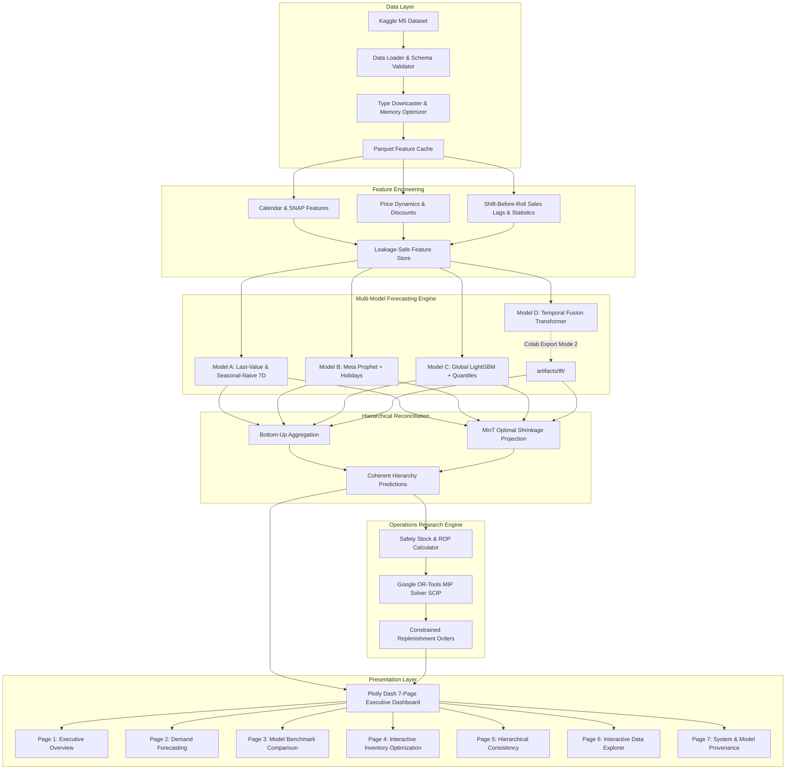

# System Architecture Documentation

## Nationwide Retail Demand Forecasting & Inventory Optimization System

This document outlines the end-to-end software and data science architecture of the Nationwide Demand Forecasting and Inventory Optimization platform.

---

## 1. Modular Architecture Overview

The system is organized into modular decoupled layers:

| Module / Package | Path | Responsibility |
| :--- | :--- | :--- |
| **Configuration** | `config/settings.py` | Centralized paths, forecast horizons, random seeds, and inventory defaults. |
| **Data Ingestion & Validation** | `src/data/` | CSV ingestion, downcasting (`reduce_mem_usage`), schema validation, missing/duplicate checks, and parquet caching. |
| **Feature Engineering** | `src/features/` | Calendar indicators, SNAP benefits, weekly price changes, and strict shift-before-rolling lag/rolling statistics. |
| **Forecasting Engine** | `src/models/` | Naive baselines, Prophet, LightGBM (point + quantiles), TFT Colab integration bridge, and Model Registry. |
| **Evaluation & Backtesting** | `src/evaluation/` | Chronological splitting (no shuffling), WAPE, RMSE, MAE, Signed Bias, and in-sample RMSSE. |
| **Uncertainty & Reconciliation** | `src/forecasting/` | 80%/95% interval evaluation, Bottom-Up summation, and MinT (Minimum Trace) shrinkage projection. |
| **Operations Research** | `src/optimization/` | Safety stock, Reorder Point, and Google OR-Tools Mixed-Integer Linear Programming (MIP) replenishment engine. |
| **Executive Dashboard** | `dashboard/`, `app.py` | Responsive 7-page Plotly Dash application with live what-if parameter re-optimization. |
| **Automated Test Suite** | `tests/` | 24 unit and integration tests verifying leakage prevention, metrics, reconciliation, and OR-Tools constraints. |
